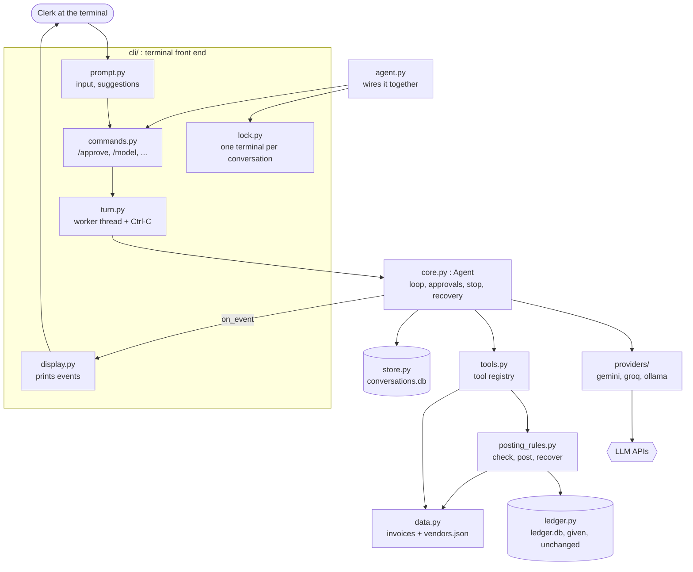
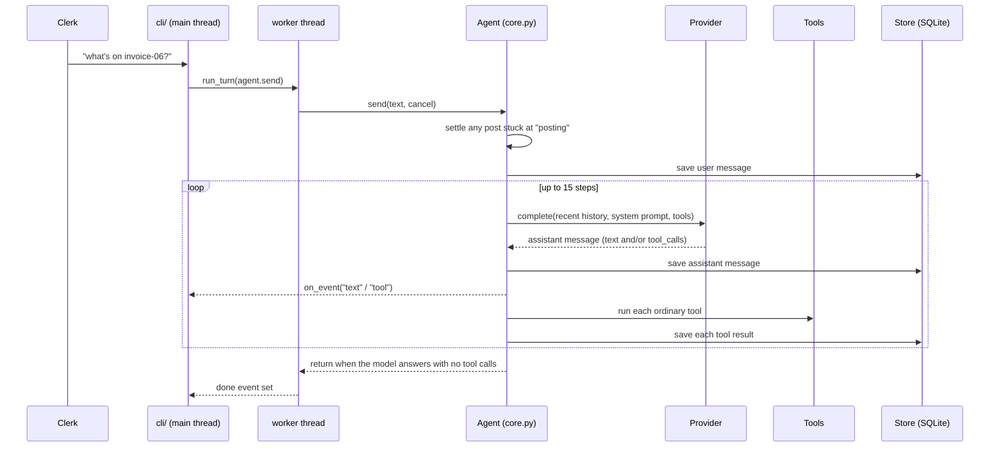
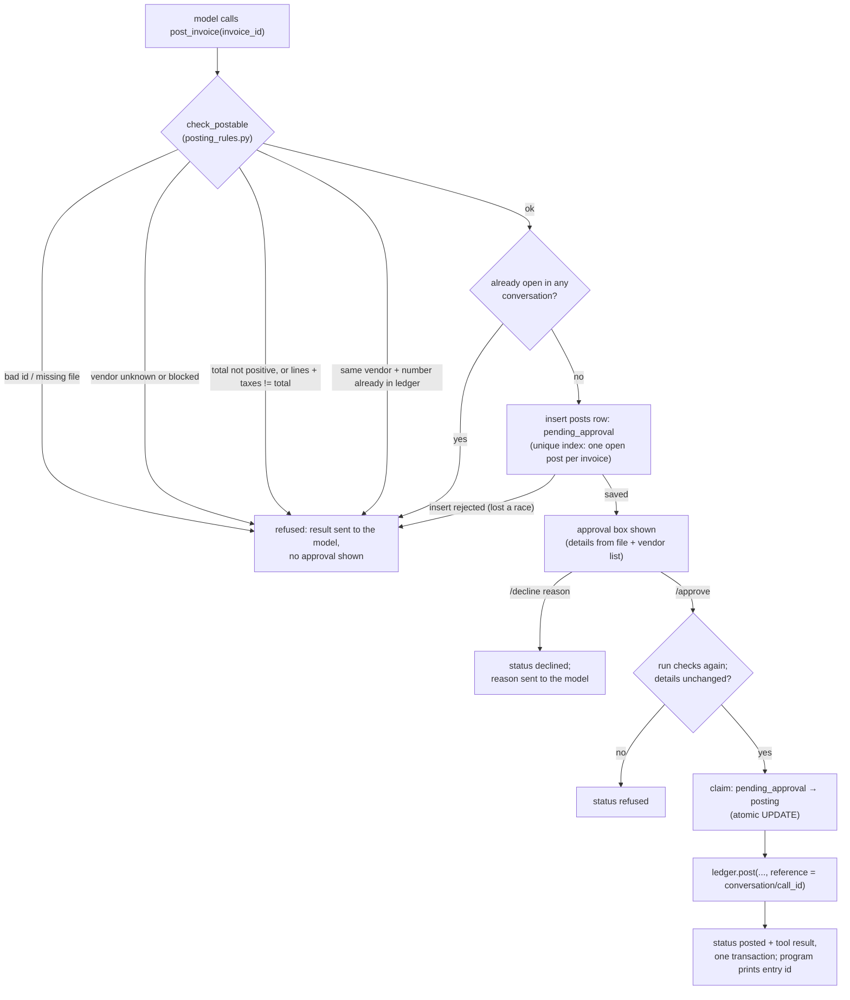
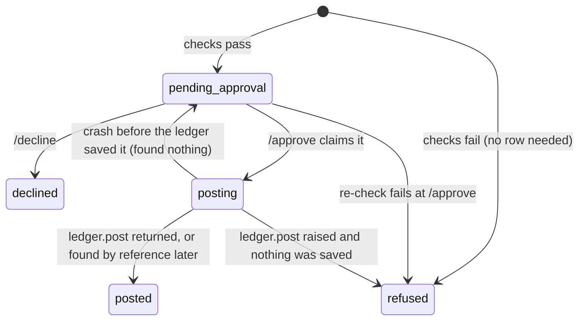

# Architecture guide

How the Acme Foods AP agent is built, what happens on every turn, and what happens when
things go wrong. Read [README.md](README.md) first for how to run it, and
[ASSIGNMENT.md](ASSIGNMENT.md) for the original brief.

---

## 1. The big picture

A clerk types in a terminal. An LLM decides which tools to call. **Code, not the model,
decides whether anything may be posted, and a person approves every post.** Everything is
saved as it happens, so the program can be stopped or killed at any moment and resume
safely.



**Dependency rule:** arrows only point downwards. `core.py` never prints and never names a
provider. Tools never know about the agent. Providers never know about tools beyond a
name, a description and a JSON schema. So each layer can be read, tested and replaced on
its own.

---

## 2. Module map

| File | Lines | Job | Talks to |
|---|---|---|---|
| `agent.py` | ~100 | Entry point. Parses args, takes the lock, opens the conversation, runs crash recovery, then the input loop. | `cli/*`, `core`, `store` |
| `cli/prompt.py` | ~95 | Reads a line. With a terminal it uses `prompt_toolkit` (command menu, ghost text, history in `.agent_history`); when piped, plain `input()`. | `tools.list_invoices` for suggestions |
| `cli/commands.py` | ~85 | `COMMANDS` table and `handle(line)`: slash commands, or a message for the agent. | `cli.turn`, `cli.display`, `Agent` |
| `cli/turn.py` | ~85 | `run_turn`: runs one turn on a worker thread, handles Ctrl-C, reports failures, tidies the history. | `Agent` |
| `cli/display.py` | ~60 | `show_event` (the Agent's `on_event` callback), the approval box, `/history`, the status bar. | nothing (pure output) |
| `cli/lock.py` | ~30 | `flock` / `msvcrt.locking` on `.locks/<conversation>.lock`. | OS |
| `core.py` | ~340 | `Agent`: the model ↔ tool loop, approvals, cancel checks, crash and stop repair, history trimming. No I/O. | `providers`, `tools`, `store` |
| `tools.py` | ~150 | `Tool` dataclass, the four read tools, the `TOOLS` registry, `run_tool`. | `data`, `posting_rules`, `ledger` |
| `posting_rules.py` | ~95 | `check_postable` (all posting checks), `post_to_ledger`, `find_interrupted_post`. | `data`, `ledger` |
| `data.py` | ~45 | Reads invoice files (with id validation) and `vendors.json`. | files |
| `store.py` | ~190 | SQLite: conversations, messages, posts. | `conversations.db` |
| `providers/base.py` | ~120 | `Provider` protocol, `with_retries`, error types, call ids. | – |
| `providers/{gemini,groq,ollama}.py` | ~100–155 each | One connector per SDK: neutral history → SDK request → neutral reply. | the SDK |
| `providers/__init__.py` | ~30 | `PROVIDERS` registry and `create(name)` (reads key and model from the environment). | connectors |
| `ledger.py` | 143 | The given fake ERP. **Not modified.** Saves the entry *before* returning (by design). | `ledger.db` |

---

## 3. The neutral conversation format

Every provider speaks a different dialect. Internally there is exactly one shape, defined
in `providers/base.py`:

```python
{"role": "user", "text": "post invoice-01"}
{"role": "assistant", "text": "", "tool_calls": [{"id": "call_ab12", "name": "post_invoice",
                                                  "args": {"invoice_id": "invoice-01"}}],
 "meta": {"gemini": {...}}}                       # optional, opaque to everyone else
{"role": "tool", "call_id": "call_ab12", "name": "post_invoice", "result": {...}}
```

- Every tool call has an id, and every call must eventually get exactly one `tool` result.
  This **pairing rule** is what both APIs require, and most of the stop and crash logic
  exists to keep it true.
- `meta.<provider>` holds data only one provider understands (Gemini's thought signatures).
  Other connectors ignore it.
- Each connector converts the **whole** history on every call. Switching provider changes
  only which connector does the next conversion; nothing is rewritten.

| | Groq (OpenAI style) | Gemini |
|---|---|---|
| Tool call | `tool_calls[].function.arguments` (JSON string) | `function_call` part |
| Tool result | `role: tool`, `tool_call_id` | `function_response` parts; consecutive results merged into one user turn |
| Provider-only data | – | thought signatures replayed; calls made by Groq get Google's documented placeholder signature |
| Malformed tool args | parsed; if not JSON, passed as `_unparsed_arguments` so the tool returns a readable error | – |

---

## 4. One turn, step by step



Key points:

- **Saved before acting.** The user message is saved before the model is called. Each
  assistant message is saved before its tools run, and each result as soon as it exists.
- **Every save checks the turn's cancel event under a lock** (`Agent._save`). Once the clerk
  has pressed Ctrl-C, an abandoned turn can't write anything.
- **History sent to the model** is `_recent(history)`: at most 200 messages, cut at a user
  message so no tool call loses its result.
- `MAX_STEPS = 15` stops a model that never gives a final answer.
- Tool errors (bad args, unknown tool, corrupt file) come back as `{"error": ...}` results
  the model can read; they never end the turn.

---

## 5. Posting: checks, approval, ledger

The model can only call `post_invoice(invoice_id)`. What gets posted is built in code:



### Post states (`posts.status`)



### Why each guard exists

| Guard | Stops |
|---|---|
| Model passes only `invoice_id` | The model inventing an amount, vendor or bank detail |
| `invoice-\d{2}` id check | Path tricks like `../vendors` |
| Vendor `active` check | Paying blocked vendors (test case 6) |
| Arithmetic check | Posting an invoice whose lines and taxes don't add up |
| Ledger duplicate check | Posting the same invoice twice (test case 7) |
| Partial unique index `one_open_post_per_invoice` | Two conversations getting approvals for the same invoice at the same moment |
| Re-check at `/approve` | The invoice or vendor changing while the approval waited |
| Atomic claim (`UPDATE ... WHERE status='pending_approval'`) | Two processes approving the same post |
| `reference = conversation/call_id` | Knowing, after a crash, whether a post reached the ledger |
| Chat refused while an approval waits | Out-of-order history; the model talking past a pending post |

---

## 6. Threads, stop and Ctrl-C

```
main thread                         worker thread
-----------                         -------------
run_turn() starts worker  ───────►  agent.send / approve / decline (cancel event)
waits on `done` Event               ... model calls, tools, saves ...
  every 15 s prints "still working"
Ctrl-C ─► cancel.set()
          wait ≤ 1 s  ─────────────  every save sees cancel → raises Cancelled
          (or until agent.posting    retry backoffs wake on cancel
           clears, if a post is      an approved ledger.post is NOT cut off
           running)
          agent.stopped() closes
          dangling tool calls
          back to the prompt         (thread may still be finishing an HTTP call;
                                      it can't save or print anything)
```

- **Why an Event, not `Thread.join()`:** a Ctrl-C that interrupts `join()` makes CPython
  mark the thread as finished while it is still running. An earlier version let a post
  finish unattended because of this.
- **Ctrl-C during an approved post:** the first press waits for it (about 2 s) and records
  the result. A further press quits at once (`os._exit`). That is the same as a crash
  mid-post, and recovery (below) settles it on the next start.
- `agent.posting` is set *inside the same lock* that checks cancel and claims the post. So
  a stop either happens before the claim (nothing posted, approval still waiting) or after
  it (the post completes and is recorded). There is no in-between.
- `_emit` drops events from a stopped turn, so nothing prints after "Stopped". A post that
  completes during a stop is still announced.

---

## 7. Crash and kill recovery

The program can die anywhere: kill -9, terminal closed, laptop lid, power. SQLite commits
each write atomically, so the question is only *which* writes happened. On startup,
`agent.recover()` runs:

1. `_settle_interrupted()`: every post of this conversation still at `posting` is looked up
   in the ledger by its `reference`. Found → `posted` with the real entry id. Not found →
   back to `pending_approval`, so the clerk is asked again. **Never retried blindly.**
2. `_repair()`: every tool call without a result gets `{"error": "stopped before this tool
   ran; no action was taken"}`, then a short assistant note. Calls still waiting for
   approval are left open on purpose.

| Killed while… | What's on disk | On restart |
|---|---|---|
| waiting for the model | user message, no reply | note added; the clerk re-asks |
| a read tool was running | assistant tool call, no result | call closed with "stopped"; the model sees it |
| between saving the call and saving the pending row | call, no row | call closed; nothing to approve |
| the approval box was showing | row `pending_approval` | approval box shown again (test case 2) |
| `ledger.post` was running, entry not yet saved | row `posting`, no ledger entry | back to `pending_approval` |
| `ledger.post` saved the entry but hadn't returned | row `posting`, entry with our reference | marked `posted` with that entry id |
| saving the final result | one transaction: all or nothing | as one of the two rows above |

The same `_settle_interrupted()` also runs **before every new turn**. So if `ledger.post`
raised mid-session and even the follow-up lookup failed, the next message settles it and
the conversation keeps working.

---

## 8. Storage (`conversations.db`)

```sql
conversations(name PK, model, created_at)              -- model updated on /model
messages(conversation, seq, body JSON, PK(conversation, seq))
posts(call_id PK, conversation, invoice_id, vendor_id, invoice_number,
      details JSON, status, entry_id, reason, updated_at)
UNIQUE INDEX one_open_post_per_invoice ON posts(vendor_id, invoice_number)
      WHERE status IN ('pending_approval', 'posting')
```

- Each method opens a short-lived connection and commits on exit. There's no long-held
  transaction, so other terminals (other conversations) never block for long.
- `resolve_post` writes the final status **and** the tool-result message in one
  transaction, so a post can't end up "posted" without the model being told, or the reverse.
- `ledger.db` is separate and owned by `ledger.py`. Cross-database atomicity isn't
  possible, which is exactly why `reference` exists.

---

## 9. Providers and failure handling

`providers/__init__.py` holds the registry. `create(name)` reads `<ENV_KEY>` and an optional
`<NAME>_MODEL`. All network calls go through `with_retries` (`providers/base.py`):

| Failure | Behaviour |
|---|---|
| Request takes over 45 s | Timeout, retried |
| Network drops / connection refused (any provider) | Retried, shown as "connection failed (network down?)" |
| 5xx, short 429 | Retried with doubling waits (≤ 30 s), up to 5 tries, each shown on screen |
| Quota resetting in over a minute (Gemini daily tier) | Fails at once: "quota used up; resets in 13h 28m; switch with /model" |
| Groq malformed tool call (`tool_use_failed`) | Retried (the model usually gets it right the next time) |
| Other API errors (bad key, 400) | `ProviderError` with the provider's message; turn fails cleanly |
| Ctrl-C during a backoff | Wakes immediately |
| Gemini returns nothing (safety, empty) | A visible "(the model returned nothing: REASON)" reply |

When a turn fails, `cli/turn.py` prints the error and calls `agent.stopped(note)`. The history
stays valid, so the clerk can `/model` to another provider and carry on in the same
conversation.

Other errors:

- **Storage errors** (disk full, locked DB) during a command are printed and the loop
  continues. A corrupt database at startup gives a plain message, not a traceback.
- **Ctrl-C at the prompt** prints "(type /quit to leave)". Ctrl-D quits. Everything is
  already saved.

---

## 10. Invariants (what is always true)

1. Nothing reaches the ledger without `check_postable` passing **twice** (at request and at
   approval) and a clerk typing `/approve`.
2. At most one open (`pending_approval` or `posting`) post exists per vendor + invoice
   number, across all conversations (enforced by SQLite).
3. A post is attempted at most once per approval. After any interruption the ledger is
   consulted, never re-posted blindly.
4. Every tool call in the history sent to a model has exactly one result, except calls
   waiting for approval, and chat is blocked while those exist.
5. A stopped turn writes nothing after the stop, except the outcome of a post already
   running.
6. Only one process holds a given conversation (OS lock).

---

## 11. Extending it

**Add a provider.** Create `providers/<name>.py` with a class that has `name`, `env_key`,
`default_model`, `__init__(api_key, model)` and `complete(history, system, tools, cancel,
notify) -> assistant message`. Convert the neutral history in and the reply out, and wrap
the SDK call in `with_retries`. Then add one line to `PROVIDERS`. Nothing else names a
provider.

**Add a tool.** Add a function and a `Tool(...)` entry to `TOOLS` in `tools.py`. If it
changes something in the outside world, give it `needs_approval=True` and a `prepare`
(checks → details), a `run(details, reference)` and a `recover(details, reference)`. It
then goes through the same approval, stop and crash path as posting, with no change to
`core.py`.

---

## 12. Tests (`uv run pytest`, offline)

A `FakeProvider` (in `tests/conftest.py`) replays scripted replies, and the ledger's sleeps
are patched out.

| File | Covers |
|---|---|
| `test_agent.py` | Guards, approve/decline, restart with a waiting approval, crash recovery both ways, provider switching, stop mid-turn and mid-model-call |
| `test_edge_cases.py` | Race for one invoice across conversations, dropped connections retried, a stuck post settled next turn, entry id announced by code, history trimming, arithmetic check |
| `test_cli.py` | Input suggestions, Ctrl-C during a real 2 s post (twice), every odd command line |
| `test_providers.py` | Gemini/Groq conversion, signatures, merged tool results, quota parsing |
| `test_retries.py` | Backoff, give-up, stop during backoff, non-retryable errors |

---

## 13. Known limits

- Older turns beyond ~200 messages are dropped, not summarised.
- No streaming. One approval is shown at a time; others queue (`/pending`).
- A post left `posting` by a crashed conversation blocks that invoice in other
  conversations until the crashed one is reopened. The refusal names it.
- Duplicates are matched on vendor + invoice number only. The same amount under a new
  number isn't caught.
- No tests against the real SDKs. Real-provider runs of the seven brief cases were done by
  hand.
